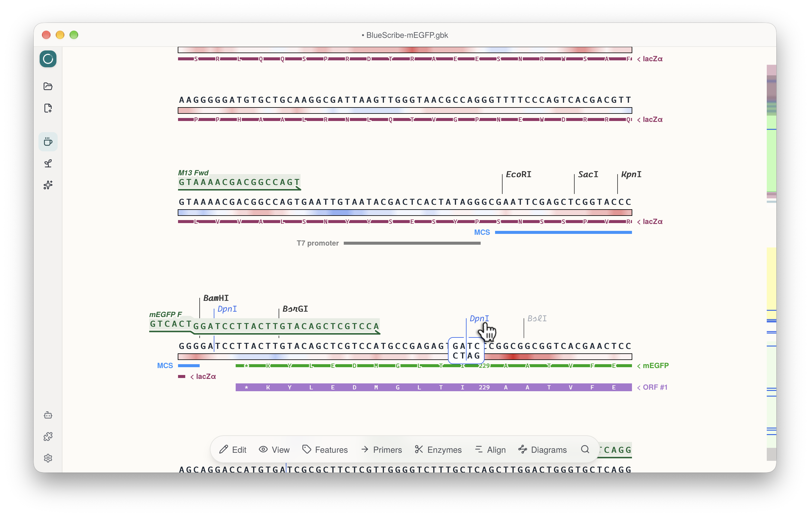
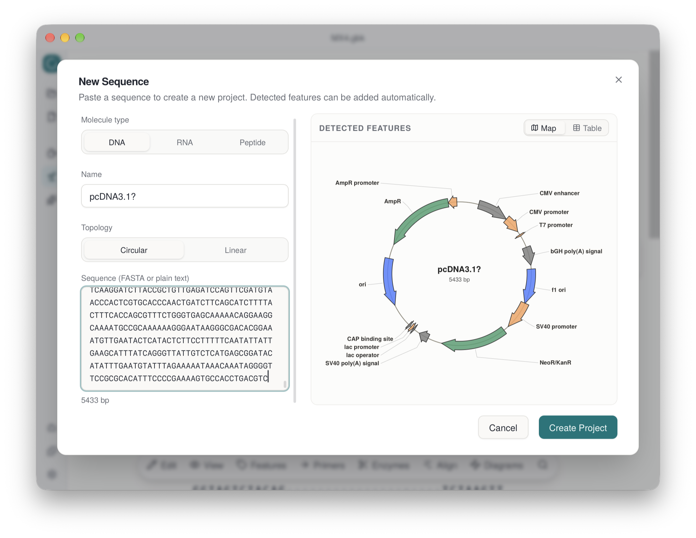
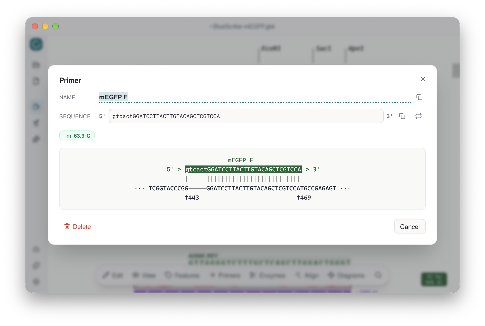
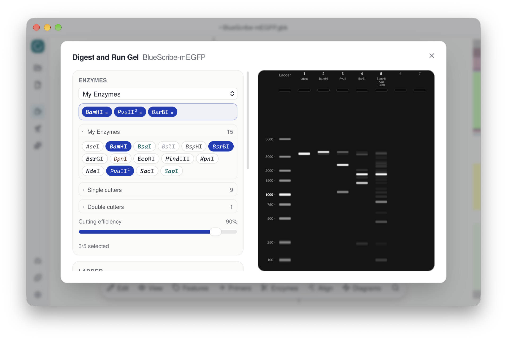
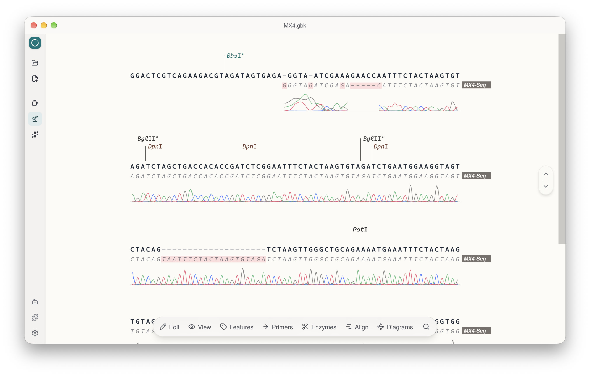
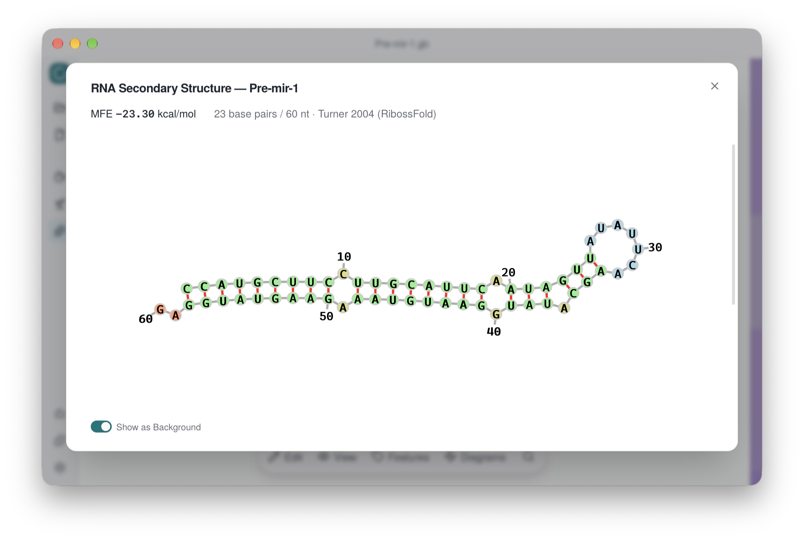

<p align="center">
  
</p>

<h1 align="center">LibreGene — Plasmid Editor</h1>

<p align="center">
  <a href="LICENSE"></a>
</p>

<p align="center"><a href="README.zh-CN.md">中文版</a></p>

A lightweight cross-platform desktop plasmid editor. Feature annotation, primer design, restriction analysis, sequence alignment, RNA folding — all free and open-source.

<p align="center">
  
</p>

## Features

### Feature Annotation

- **Clean, minimal display** — CDS and mRNA features are translated on the fly, amino acids rendered right under the sequence
- **Auto-detection** — paste a sequence into the _New Sequence_ dialog and common features (promoters, resistance markers, ori, tags…) are detected automatically and can be annotated with one click
- **ORF search** — scan open reading frames on both strands, all six frames, displayed inline
- **GC content track** — sliding-window GC% rendered as a gradient band below the sequence, with adjustable window size
- Compound (multi-segment) features, custom colors, strand toggling, enriched GenBank I/O that preserves colors and primers

<p align="center">
  
</p>

### Primers

- **Binding visualization** — mismatches, annealing region and Tm shown at a glance for every primer
- **Assisted design** — fragment amplification, overlap-extension PCR (OE-PCR) and site-directed mutagenesis, with candidates ranked by Tm / GC% and optional restriction-site tails

<p align="center">
  
</p>

### Codon Optimization

- **9 species codon usage tables** — optimize any CDS/mRNA feature for the expression host of your choice
- **Three strategies** — use best codon, match codon usage, or harmonize against the source species
- **Preview before applying** — translation check, CAI and GC% before/after at a glance; optionally avoid creating specified restriction sites

### Restriction Enzymes

- **Built-in 900+ enzyme database** with methylation-aware filtering
- **Clear categorization** — unique cutters, twice cutters, blunt ends and Type IIS enzymes are distinguished visually, and cut sites are marked on the feature scrollbar for quick navigation
- **Custom enzyme sets** — define your own enzyme collections and switch between them
- **Provider detail data** — per-enzyme buffer compatibility, incubation temperature, methylation sensitivity and inactivation info from **New England Biolabs**, **Thermo Fisher FastDigest** and **Yugong Biotech (BestEnzymes)**

### Digest and Run Gel

- **In-silico digest simulation** — pick enzymes, set cutting efficiency, and enumerate every resulting fragment, including partial-digest products
- **Virtual gel electrophoresis** — agarose/PAGE matrix, concentration and run-time controls with built-in or custom ladders; topology-aware migration (uncut circles run as supercoiled bands) and band diffusion are modeled

<p align="center">
  
</p>

### Sequence Alignment

- **Multiple formats** — import Sanger reads (.ab1), FASTA or GenBank sequences and align them against the reference
- Mismatches, insertions and deletions highlighted in place, per-read identity computed automatically
- **Sanger chromatogram display** — open a `.ab1` file to see its trace curves alongside the sequence

<p align="center">
  
</p>

### RNA Secondary Structure

- **MFE folding** — minimum-free-energy secondary structure prediction, computed locally
- **Interactive layout** — force-directed structure view with pan/zoom and draggable nucleotides; can be shown as the editor background

<p align="center">
  
</p>

### MCP / LLM Agent Integration

LibreGene embeds an [MCP](https://modelcontextprotocol.io) server (loopback only at `127.0.0.1:8766`, Bearer-token auth) so an LLM agent in your terminal can operate the open plasmid like a real user — while the UI updates live. Launch LibreGene, open the _MCP Server_ dialog in the sidebar (or the "Connect an LLM agent via MCP" link on the empty screen), and copy the auto-generated setup prompt — with the URL and access token embedded — to your agent; it configures the connection itself.

16 tools are exposed, covering the full editing workflow:

- **Projects & files** — `open_project`, `save_file` (with subsequence/region export), `list_workspace`, `add_to_workspace`
- **Reading** — `read_sequence`, `get_project_overview`, `get_region_view`
- **Editing** — `edit_sequence` (insert/delete/replace), `set_feature` (create & update)
- **Primers** — `add_primer`, `test_primers` (ad-hoc binding checks with Tm and amplicon size), `design_primers` (amplify / OE-PCR / mutagenesis)
- **Analysis** — `find_restriction_sites`, `find_orfs`, `add_alignment`, `convert_sequence` (sequence conversion + codon optimization for 9 species)

#### Example Tasks

Ready-to-run agent tasks live in [`examples/tasks`](examples/tasks), each with a `Prompt.txt` you can hand to your agent and a reference result:

- **[Primer Design](examples/tasks/Primer%20Design)** — clone mEGFP into a BamHI/HindIII-digested BlueScribe vector: design cloning primers with restriction tails, pick colony-PCR verification primers, then design A206K mutagenesis primers
- **[Alignment](examples/tasks/Alignment)** — given pVA-MCS and three Sanger `.ab1` reads, determine which samples successfully mutated away the BbsI site
- **[RNAi](examples/tasks/RNAi)** — given a vector and an experimental protocol, design an RNAi plasmid targeting a gene of interest with a given antisense sequence
- **[CAR-T](examples/tasks/CAR-T)** — given the amino-acid sequence of an anti-CD19 CAR (FMC63 scFv–CD28–CD3ζ), design a pLVX-CAR-IRES-ZsGreen1 expression vector

### And More

- **Circular plasmid map view** alongside the sequence editor
- **DNA / RNA / protein modes** — single-strand editors for RNA and protein sequences
- **Wrap and continuous view modes** — multi-line wrapping or a single horizontally scrollable line
- **BLAST search** — right-click any selection to submit it to NCBI BLAST
- **SnapGene history** — browse snapshots embedded in .dna files
- **Plugin system** — extensible architecture for adding custom tools
- **Multi-project tabs** — switch between plasmids in the sidebar
- **Full undo/redo** — sequence edits and feature changes
- **GenBank / SnapGene / FASTA I/O** — read/write .gb/.gbk and protein .gpt; read .dna/.rna/.prot ([SnapGene](https://www.snapgene.com)), FASTA and Sanger .ab1

## Plugins

LibreGene supports plugins — the dotplot viewer and gel simulator in [`src/plugins/`](src/plugins/) are examples. Want to build one? Check the [plugin development guide](src/plugins/README.md) and open a PR. Contributions welcome!

## Installation

**macOS (Homebrew, Apple Silicon):**

```bash
brew install --cask dl-li/libregene/libregene
```

The app is not notarized yet, so on first launch use right-click → **Open** (or approve it in System Settings → Privacy & Security).

Alternatively, download installers for macOS (dmg), Windows (msi / nsis) and Linux (Flatpak) directly from [GitHub Releases](https://github.com/dl-li/LibreGene/releases).

## Quick Start

```bash
npm install
npx tauri dev
```

Requires Node.js ≥ 20, Rust ≥ 1.75, and [Tauri v2 prerequisites](https://v2.tauri.app/start/prerequisites/).

## License

GNU General Public License v3.0 — see [LICENSE](LICENSE).

Copyright (C) 2025 dl-li

## Acknowledgements

Thanks to our contributors [liu1568075](https://github.com/liu1568075) and [Masterchiefm](https://github.com/Masterchiefm).

This project also builds on many great open-source tools, including [pLannotate](https://github.com/mmcguffi/pLannotate), [pydna](https://github.com/pydna-group/pydna), [DNA Chisel](https://github.com/Edinburgh-Genome-Foundry/DnaChisel), [Biopython](https://biopython.org) and [RibossFold](https://github.com/mirditalab/RibossFold).
